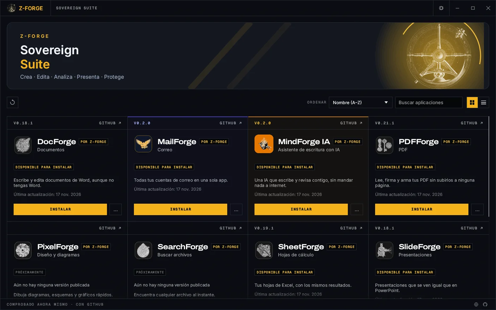
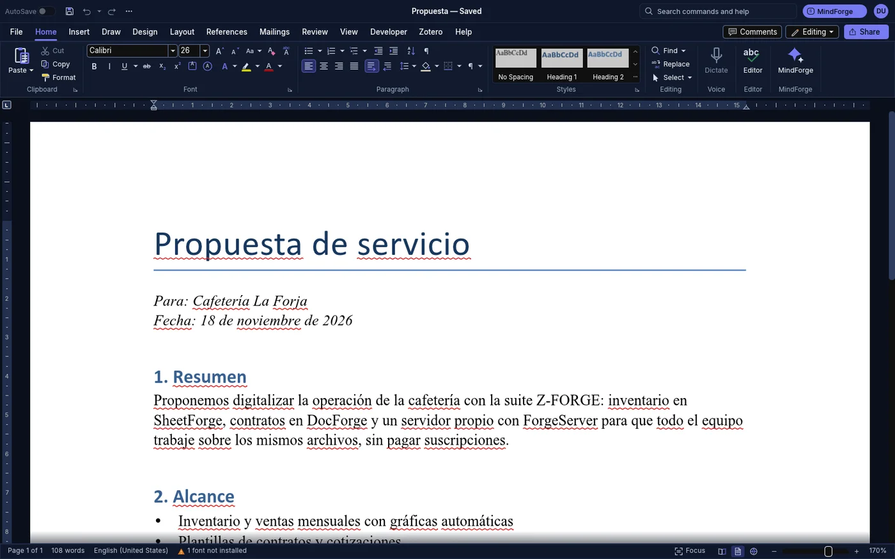
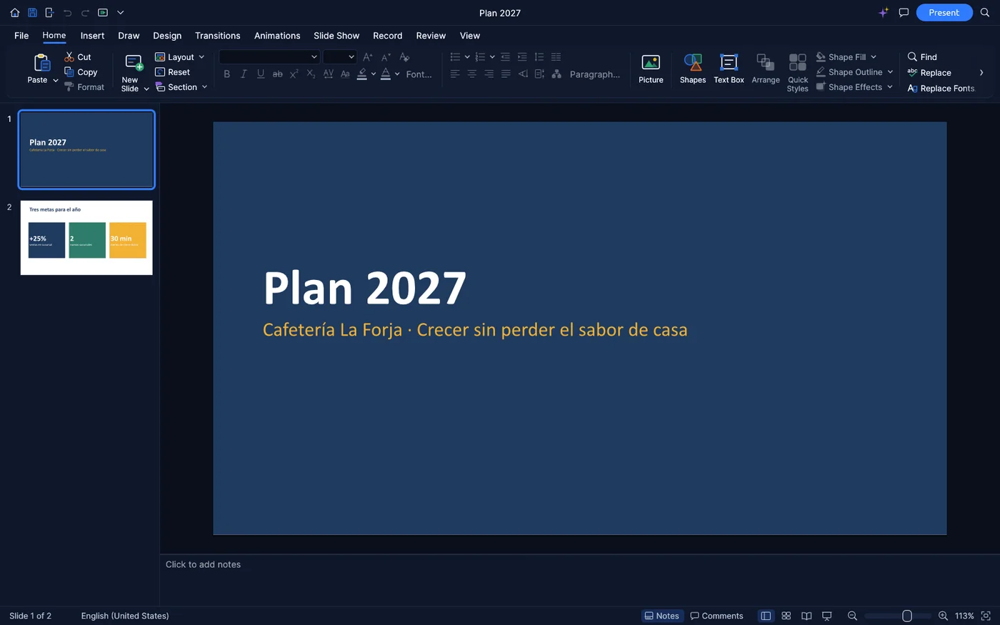
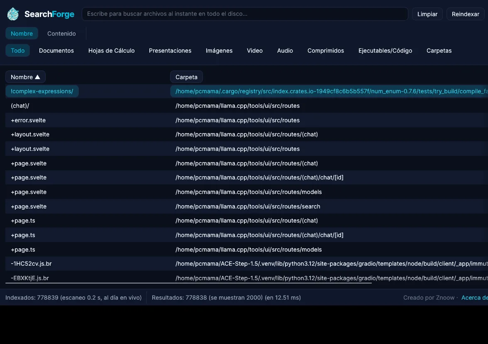
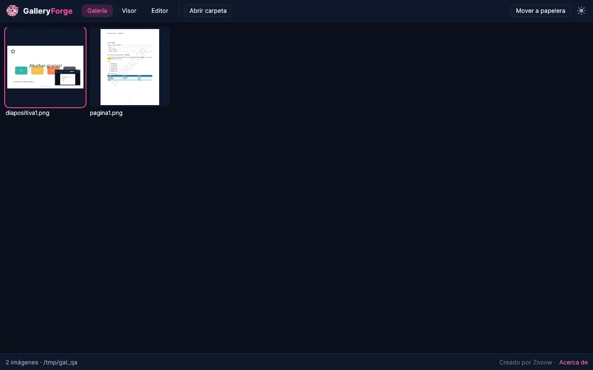
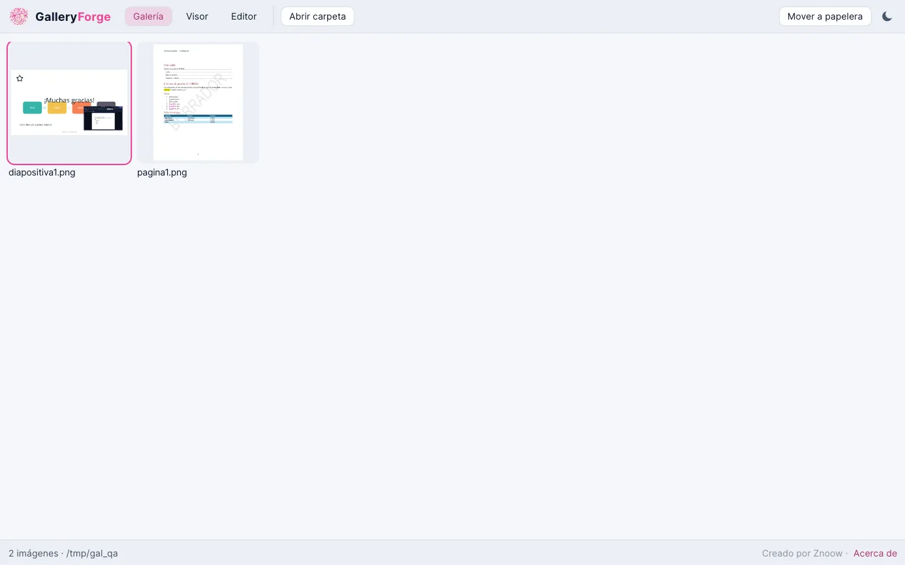
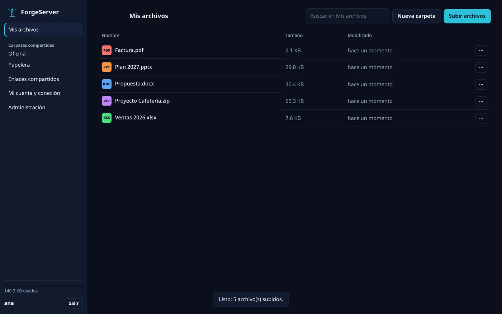
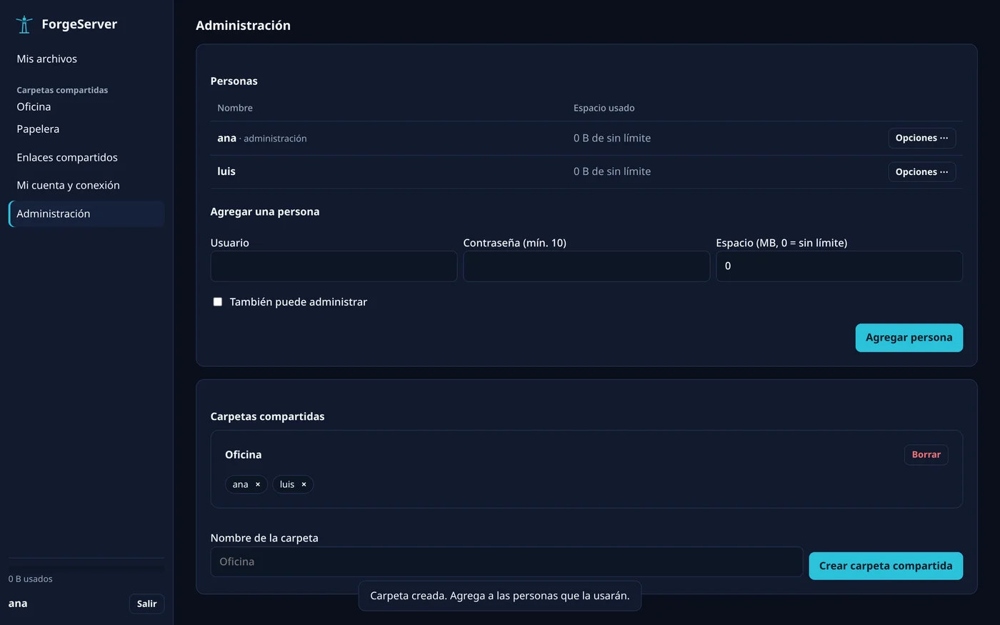

<h1 align="center">Z-FORGE</h1>
<p align="center"><b>Una suite de oficina completa que vive en tu computadora, y en tu propio servidor si lo quieres.</b><br>
Hojas de cálculo, documentos, presentaciones, PDF, correo y más. Sin suscripción, sin cuenta, funciona sin internet.</p>
<p align="center">            </p>
<p align="center"><a href="README.md">English</a> · <b>Español</b></p>

<p align="center"><br><sub>SheetForge abriendo un reporte de ventas de Excel con su gráfica</sub></p>

## Empieza aquí

**Windows:** en la tabla de abajo, descarga el **Instalador** de la app que quieras y ábrelo: Siguiente → Instalar, y queda en el menú Inicio y en el escritorio. No pide contraseña de administrador y se quita como cualquier programa desde *Configuración → Aplicaciones*. Si prefieres no instalar nada, descarga el **.exe** y ábrelo directo.

> [!IMPORTANT]
> **Windows te va a mostrar un aviso la primera vez. Es normal.**
> Los programas de Z-FORGE todavía no tienen firma digital de pago (un certificado cuesta entre 200 y 400 dólares al año), así que Windows no reconoce al autor y muestra **«Windows protegió tu PC»**. Para abrirlo:
> 1. Da clic en **Más información**.
> 2. Da clic en **Ejecutar de todas formas**.
>
> Solo se pide una vez por archivo. Si tu navegador (Edge o Chrome) dice que el archivo «no se descarga con frecuencia», elige **⋯ → Conservar** (en Edge: *Mostrar más → Conservar de todos modos*).
> ¿Quieres comprobar que el archivo es el original? Cada versión trae `SHA256SUMS.txt`; en PowerShell: `Get-FileHash .\archivo.exe` y compara el número.

**Linux:** copia esto en una terminal y presiona Enter:

```bash
curl -fsSL https://raw.githubusercontent.com/znoowmk/zforge-releases/main/instalar.sh | sh
```

Eso instala **ForgeLauncher** con su ícono en el menú. Ábrelo y elige las apps: él las descarga, las instala y te avisa cuando hay versiones nuevas. No pide contraseña de administrador.

<p align="center"><br><sub>ForgeLauncher</sub></p>


## Las apps

| | App | Para qué sirve | Linux | Windows |
|---|---|---|---|---|
|  | **SheetForge** | Hojas de cálculo. Abre `.xlsx`, `.xls`, `.ods` y `.csv`, y tus fórmulas dan lo mismo que en Excel. Trae **Macros IA**: dices qué quieres automatizar y escribe la macro, la prueba en una copia y te muestra qué cambiaría. | [0.19.6](https://github.com/znoowmk/zforge-releases/releases/download/sheetforge-v0.19.6/sheetforge-0.19.6-linux-x86_64.tar.gz) | [Instalador](https://github.com/znoowmk/zforge-releases/releases/download/sheetforge-v0.19.6/sheetforge-0.19.6-windows-x64-setup.exe) · [.exe](https://github.com/znoowmk/zforge-releases/releases/download/sheetforge-v0.19.6/sheetforge-0.19.6-windows-x64.exe) · [.zip](https://github.com/znoowmk/zforge-releases/releases/download/sheetforge-v0.19.6/sheetforge-0.19.6-windows-x64-portable.zip) |
|  | **DocForge** | Documentos. Escribe y edita archivos de Word aunque no tengas Word (`.docx`, `.odt`). Trae **MindForge**, un asistente de IA que mejora la redacción, corrige, resume y traduce con modelos en tu propio equipo. | [0.18.5](https://github.com/znoowmk/zforge-releases/releases/download/docforge-v0.18.5/docforge-0.18.5-linux-x86_64.tar.gz) | [Instalador](https://github.com/znoowmk/zforge-releases/releases/download/docforge-v0.18.5/docforge-0.18.5-windows-x64-setup.exe) · [.exe](https://github.com/znoowmk/zforge-releases/releases/download/docforge-v0.18.5/docforge-0.18.5-windows-x64.exe) · [.zip](https://github.com/znoowmk/zforge-releases/releases/download/docforge-v0.18.5/docforge-0.18.5-windows-x64-portable.zip) |
|  | **SlideForge** | Presentaciones que se ven igual que en PowerPoint (`.pptx`, `.odp` y los `.ppt` antiguos), con gráficas, SmartArt, transiciones y vista de orador. | [0.18.5](https://github.com/znoowmk/zforge-releases/releases/download/slideforge-v0.18.5/slideforge-0.18.5-linux-x86_64.tar.gz) | [Instalador](https://github.com/znoowmk/zforge-releases/releases/download/slideforge-v0.18.5/slideforge-0.18.5-windows-x64-setup.exe) · [.exe](https://github.com/znoowmk/zforge-releases/releases/download/slideforge-v0.18.5/slideforge-0.18.5-windows-x64.exe) · [.zip](https://github.com/znoowmk/zforge-releases/releases/download/slideforge-v0.18.5/slideforge-0.18.5-windows-x64-portable.zip) |
|  | **PDFForge** | Lee, rellena, firma, une, divide, censura y protege PDF sin subirlos a ninguna página. Con OCR para escaneos y un asistente de IA que **resume, responde preguntas y traduce** el documento. | [0.21.5](https://github.com/znoowmk/zforge-releases/releases/download/pdfforge-v0.21.5/pdfforge-0.21.5-linux-x86_64.tar.gz) | [Instalador](https://github.com/znoowmk/zforge-releases/releases/download/pdfforge-v0.21.5/pdfforge-0.21.5-windows-x64-setup.exe) · [.exe](https://github.com/znoowmk/zforge-releases/releases/download/pdfforge-v0.21.5/pdfforge-0.21.5-windows-x64.exe) · [.zip](https://github.com/znoowmk/zforge-releases/releases/download/pdfforge-v0.21.5/pdfforge-0.21.5-windows-x64-portable.zip) |
|  | **MailForge** | Todas tus cuentas de correo en una sola app, con calendario, tareas y contactos. Resume y traduce correos con IA en tu equipo. | [0.2.2](https://github.com/znoowmk/zforge-releases/releases/download/mailforge-v0.2.2/mailforge-0.2.2-linux-x86_64.tar.gz) | [Instalador](https://github.com/znoowmk/zforge-releases/releases/download/mailforge-v0.2.2/mailforge-0.2.2-windows-x64-setup.exe) · [.exe](https://github.com/znoowmk/zforge-releases/releases/download/mailforge-v0.2.2/mailforge-0.2.2-windows-x64.exe) · [.zip](https://github.com/znoowmk/zforge-releases/releases/download/mailforge-v0.2.2/mailforge-0.2.2-windows-x64-portable.zip) |
|  | **ZipForge** | Comprime y descomprime archivos, con contraseña si quieres. Ve fotos, PDF, Word, Excel y PowerPoint **dentro del ZIP sin extraerlos**. | [0.2.1](https://github.com/znoowmk/zforge-releases/releases/download/zipforge-v0.2.1/zipforge-0.2.1-linux-x86_64.tar.gz) | [Instalador](https://github.com/znoowmk/zforge-releases/releases/download/zipforge-v0.2.1/zipforge-0.2.1-windows-x64-setup.exe) · [.exe](https://github.com/znoowmk/zforge-releases/releases/download/zipforge-v0.2.1/zipforge-0.2.1-windows-x64.exe) · [.zip](https://github.com/znoowmk/zforge-releases/releases/download/zipforge-v0.2.1/zipforge-0.2.1-windows-x64-portable.zip) |
|  | **GalleryForge** | Tus fotos por carpeta: miniaturas, visor a pantalla completa, girar y mandar a la papelera. | [0.2.0](https://github.com/znoowmk/zforge-releases/releases/download/galleryforge-v0.2.0/galleryforge-0.2.0-linux-x86_64.tar.gz) | [Instalador](https://github.com/znoowmk/zforge-releases/releases/download/galleryforge-v0.2.0/galleryforge-0.2.0-windows-x64-setup.exe) · [.exe](https://github.com/znoowmk/zforge-releases/releases/download/galleryforge-v0.2.0/galleryforge-0.2.0-windows-x64.exe) · [.zip](https://github.com/znoowmk/zforge-releases/releases/download/galleryforge-v0.2.0/galleryforge-0.2.0-windows-x64-portable.zip) |
|  | **PixelForge** | Edita fotos: exposición, contraste, saturación, temperatura, viñeta y nitidez, filtros de un clic, girar y pixelar zonas para ocultar datos. Es GalleryForge abierto directo en su editor. | [0.2.0](https://github.com/znoowmk/zforge-releases/releases/download/pixelforge-v0.2.0/pixelforge-0.2.0-linux-x86_64.tar.gz) | [Instalador](https://github.com/znoowmk/zforge-releases/releases/download/pixelforge-v0.2.0/pixelforge-0.2.0-windows-x64-setup.exe) · [.exe](https://github.com/znoowmk/zforge-releases/releases/download/pixelforge-v0.2.0/pixelforge-0.2.0-windows-x64.exe) · [.zip](https://github.com/znoowmk/zforge-releases/releases/download/pixelforge-v0.2.0/pixelforge-0.2.0-windows-x64-portable.zip) |
|  | **SearchForge** | Encuentra cualquier archivo del disco al instante mientras escribes (cientos de miles en menos de un segundo), también por su contenido. | [0.3.0](https://github.com/znoowmk/zforge-releases/releases/download/searchforge-v0.3.0/searchforge-0.3.0-linux-x86_64.tar.gz) | [Instalador](https://github.com/znoowmk/zforge-releases/releases/download/searchforge-v0.3.0/searchforge-0.3.0-windows-x64-setup.exe) · [.exe](https://github.com/znoowmk/zforge-releases/releases/download/searchforge-v0.3.0/searchforge-0.3.0-windows-x64.exe) · [.zip](https://github.com/znoowmk/zforge-releases/releases/download/searchforge-v0.3.0/searchforge-0.3.0-windows-x64-portable.zip) |
|  | **MindForge** | El asistente de IA de la suite como app propia: chatea con modelos que corren en tu equipo (Ollama). | [0.2.0](https://github.com/znoowmk/zforge-releases/releases/download/mindforge-v0.2.0/mindforge-0.2.0-linux-x86_64.tar.gz) | — |
|  | **ForgeServer** | Tu propio servidor: los archivos de cada quien, carpetas compartidas, unidad de red y las apps en el navegador. | [0.2.0](https://github.com/znoowmk/zforge-releases/releases/download/forgeserver-v0.2.0/forgeserver-0.2.0-linux-x86_64.tar.gz) | [Instalador](https://github.com/znoowmk/zforge-releases/releases/download/forgeserver-v0.2.0/forgeserver-0.2.0-windows-x64-setup.exe) · [.exe](https://github.com/znoowmk/zforge-releases/releases/download/forgeserver-v0.2.0/forgeserver-0.2.0-windows-x64.exe) · [.zip](https://github.com/znoowmk/zforge-releases/releases/download/forgeserver-v0.2.0/forgeserver-0.2.0-windows-x64-portable.zip) |
|  | **ForgeLauncher** | Instala y actualiza toda la suite. | [0.19.6](https://github.com/znoowmk/zforge-releases/releases/download/forgelauncher-v0.19.6/forgelauncher-0.19.6-linux-x86_64.tar.gz) | [Instalador](https://github.com/znoowmk/zforge-releases/releases/download/forgelauncher-v0.19.6/forgelauncher-0.19.6-windows-x64-setup.exe) · [.exe](https://github.com/znoowmk/zforge-releases/releases/download/forgelauncher-v0.19.6/forgelauncher-0.19.6-windows-x64.exe) · [.zip](https://github.com/znoowmk/zforge-releases/releases/download/forgelauncher-v0.19.6/forgelauncher-0.19.6-windows-x64-portable.zip) |

Todas las versiones anteriores están en [Releases](https://github.com/znoowmk/zforge-releases/releases). En Windows hay tres opciones: el **Instalador** (recomendado), el **.exe** solo, o el **.zip** portátil para llevar en una USB. El .exe de PDFForge no trae el reconocimiento de texto (OCR) de documentos escaneados; el Instalador y el .zip sí.

## Así se ven

<p align="center"><br><sub>DocForge — una propuesta con títulos, listas y tabla</sub></p>
<p align="center"><br><sub>SlideForge — un plan de dos diapositivas</sub></p>
<p align="center"><br><sub>PDFForge — una factura, con herramientas para firmar, rellenar, unir y proteger</sub></p>
<p align="center"><br><sub>ZipForge</sub></p>
<p align="center"><br><sub>MailForge antes de agregar una cuenta</sub></p>
<p align="center"><br><sub>SearchForge — 778 mil archivos indexados y buscables al instante</sub></p>
<p align="center"><br><sub>GalleryForge en modo oscuro</sub></p>
<p align="center"><br><sub>…y en modo claro</sub></p>

Las apps salen en el idioma de tu sistema (español e inglés en todas, y más idiomas en DocForge y PDFForge), en modo claro u oscuro.

## Tu propio servidor (ForgeServer)

Z-FORGE no te obliga a usar la nube de nadie: **cada quien monta su servidor**, en la PC de la oficina, un VPS, una Raspberry Pi o Docker. Un solo programa de 7 MB, sin base de datos externa.

1. Descarga ForgeServer, descomprímelo y abre `bin/forgeserver`.
2. Te muestra la dirección para los demás equipos y un código de un solo uso. Entra a la dirección, escribe el código y crea la cuenta de administración.
3. En **Administración** agrega a las personas y crea carpetas compartidas (por ejemplo «Oficina»).

- Los archivos de cada persona desde el navegador (vista previa de PDF, fotos y texto, búsqueda, arrastrar para subir) o como unidad de red en Windows, macOS y Linux, para abrir y guardar directo desde las apps.
- Carpetas compartidas donde trabajan varias personas.
- Papelera de 30 días y las últimas 10 versiones de cada archivo, también desde la unidad de red.
- Enlaces para compartir que caducan, y espacio máximo por persona.

<p align="center"><br><sub>ForgeServer en el navegador</sub></p>
<p align="center"><br><sub>Personas y carpetas compartidas, desde el navegador</sub></p>

Guías: [Instalar ForgeServer](docs/forgeserver-instalar.md) · [Seguridad](docs/forgeserver-seguridad.md)

<details>
<summary><b>Para usuarios avanzados:</b> instalar a mano y revisar la descarga</summary>

En Linux, sin ForgeLauncher:

```bash
tar xzf sheetforge-0.19.6-linux-x86_64.tar.gz
./sheetforge-0.19.6-linux-x86_64/bin/sheetforge
```

Funciona en cualquier Linux de 2023 en adelante (glibc 2.36 o más nueva).

**¿Qué es `SHA256SUMS.txt`?** Es opcional. Trae la "huella" de cada archivo publicado: si tu descarga tiene la misma huella, llegó completa y nadie la cambió. ForgeLauncher y el instalador de arriba la revisan solos. A mano: pon el archivo junto a tu descarga y ejecuta `sha256sum -c --ignore-missing SHA256SUMS.txt`; debe decir `OK`.

</details>

## Inteligencia artificial en tu equipo

La IA de Z-FORGE corre **en tu computadora** con [Ollama](https://ollama.com): tus documentos no salen a ninguna nube. Instala Ollama, descarga un modelo (`ollama pull mistral-nemo`) y listo; cada app encuentra sola el modelo instalado.

| App | Qué hace la IA |
|---|---|
| DocForge (MindForge) | Mejora la redacción, corrige ortografía, resume, cambia a tono ejecutivo, amplía ideas y traduce; inserta o reemplaza el texto en el documento |
| SheetForge (Macros IA) | Escribe macros a partir de lo que pides, las prueba en una copia del libro y te enseña qué celdas cambiarían antes de guardarlas |
| PDFForge | Resume el PDF, responde preguntas sobre él y lo traduce (respeta los PDF que prohíben copiar su texto) |
| MailForge | Resume un correo con respuesta sugerida y lo traduce al español |

¿Prefieres otro servidor? `OLLAMA_HOST` apunta a otra máquina de tu red y `FORGE_AI_MODEL` elige el modelo.

## Modo claro y oscuro

Todas las apps tienen modo claro y oscuro. En ZipForge, SearchForge, GalleryForge, PixelForge y MailForge el botón de sol/luna de la barra cambia **todas a la vez**, y con clic derecho → *Igual que el sistema* siguen al escritorio. DocForge, SheetForge, SlideForge y PDFForge tienen su propio cambio en la barra de título o en Vista.

## ¿Por qué Z-FORGE y no Office?

| | Z-FORGE | Microsoft 365 |
|---|---|---|
| Precio | Gratis, sin suscripción | Pago mensual o anual |
| Dónde están tus archivos | En tu computadora o tu servidor | En la nube de Microsoft |
| Sin internet | Todo funciona | En parte |
| Fórmulas de Excel | Mismos resultados: comparamos 239,877 fórmulas de 1,835 archivos reales de Excel y ninguna dio distinto | — |
| Macros | Macros IA: dices qué quieres automatizar y arma y prueba la macro; también traduce VBA | VBA |
| Tamaño | Apps nativas que abren al instante | Varios GB de instalación |
| Servidor propio | ForgeServer, 7 MB | SharePoint / Exchange |

## Reportar un problema

Abre un [issue](https://github.com/znoowmk/zforge-releases/issues) con la app, la versión y, si puedes, el archivo que falla (sin datos privados).

---
© 2026 Znoow · Z-FORGE
