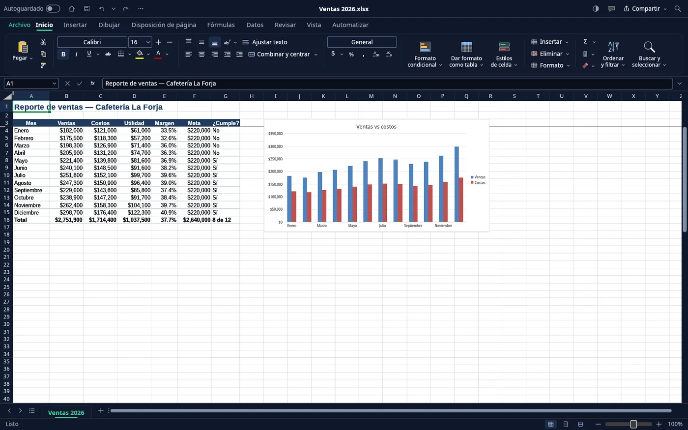
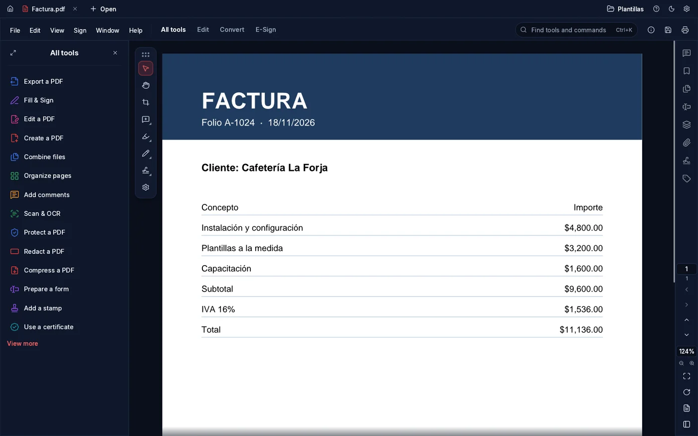
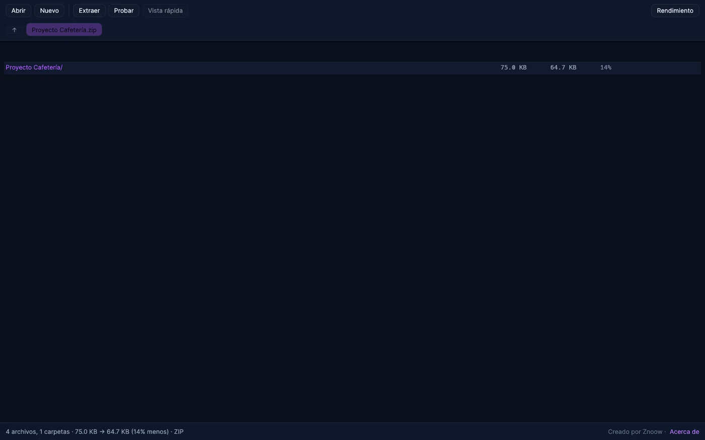
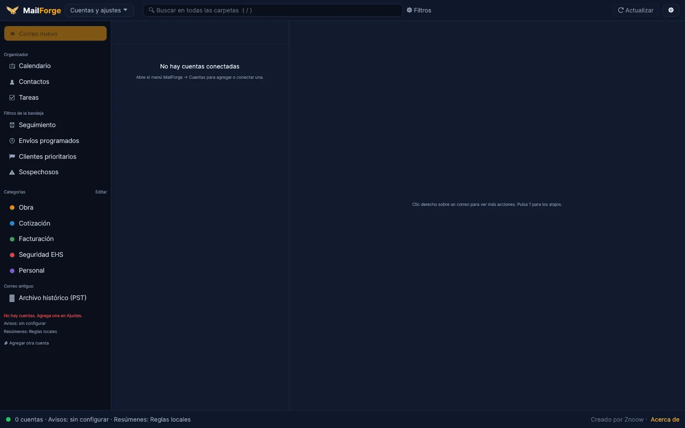

<h1 align="center">Z-FORGE</h1>
<p align="center"><b>Una suite de oficina completa que vive en tu computadora, y en tu propio servidor si lo quieres.</b><br>
Hojas de cálculo, documentos, presentaciones, PDF, correo y más. Sin suscripción, sin cuenta, funciona sin internet.</p>
<p align="center">        </p>
<p align="center"><a href="README.md">English</a> · <b>Español</b></p>

<p align="center"><br><sub>SheetForge abriendo un reporte de ventas de Excel con su gráfica</sub></p>

## Empieza aquí

Lo más fácil es **ForgeLauncher**: instala, abre y actualiza todas las apps desde una sola ventana.

1. Descarga [ForgeLauncher para Linux](https://github.com/znoowmk/zforge-releases/releases/download/forgelauncher-v0.19.5/forgelauncher-0.19.5-linux-x86_64.tar.gz).
2. Descomprímelo y abre `bin/forgelauncher`.
3. Elige las apps que quieras. Las baja de aquí, revisa cada archivo y te avisa cuando hay versión nueva.

<p align="center"><br><sub>ForgeLauncher</sub></p>

## Las apps

| | App | Para qué sirve | Linux | Windows |
|---|---|---|---|---|
|  | **SheetForge** | Hojas de cálculo. Abre `.xlsx`, `.xls`, `.ods` y `.csv`, y tus fórmulas dan lo mismo que en Excel. | [0.19.3](https://github.com/znoowmk/zforge-releases/releases/download/sheetforge-v0.19.3/sheetforge-0.19.3-linux-x86_64.tar.gz) | [.zip](https://github.com/znoowmk/zforge-releases/releases/download/sheetforge-v0.19.3/sheetforge-0.19.3-windows-x64-portable.zip) |
|  | **DocForge** | Documentos. Escribe y edita archivos de Word aunque no tengas Word (`.docx`, `.odt`). Trae **MindForge**, un asistente de IA que redacta y corrige contigo, con modelos en tu propia computadora. | [0.18.2](https://github.com/znoowmk/zforge-releases/releases/download/docforge-v0.18.2/docforge-0.18.2-linux-x86_64.tar.gz) | [.zip](https://github.com/znoowmk/zforge-releases/releases/download/docforge-v0.18.2/docforge-0.18.2-windows-x64-portable.zip) |
|  | **SlideForge** | Presentaciones que se ven igual que en PowerPoint (`.pptx`, `.odp` y los `.ppt` antiguos), con vista de orador. | [0.18.2](https://github.com/znoowmk/zforge-releases/releases/download/slideforge-v0.18.2/slideforge-0.18.2-linux-x86_64.tar.gz) | [.zip](https://github.com/znoowmk/zforge-releases/releases/download/slideforge-v0.18.2/slideforge-0.18.2-windows-x64-portable.zip) |
|  | **PDFForge** | Lee, rellena, firma, une y divide PDF sin subirlos a ninguna página. | [0.21.2](https://github.com/znoowmk/zforge-releases/releases/download/pdfforge-v0.21.2/pdfforge-0.21.2-linux-x86_64.tar.gz) | [.zip](https://github.com/znoowmk/zforge-releases/releases/download/pdfforge-v0.21.2/pdfforge-0.21.2-windows-x64-portable.zip) |
|  | **MailForge** | Todas tus cuentas de correo en una sola app, con calendario y contactos. | [0.2.0](https://github.com/znoowmk/zforge-releases/releases/download/mailforge-v0.2.0/mailforge-0.2.0-linux-x86_64.tar.gz) | [.zip](https://github.com/znoowmk/zforge-releases/releases/download/mailforge-v0.2.0/mailforge-0.2.0-windows-x64-portable.zip) |
|  | **ZipForge** | Comprime y descomprime archivos, con contraseña si quieres. | [0.2.0](https://github.com/znoowmk/zforge-releases/releases/download/zipforge-v0.2.0/zipforge-0.2.0-linux-x86_64.tar.gz) | [.zip](https://github.com/znoowmk/zforge-releases/releases/download/zipforge-v0.2.0/zipforge-0.2.0-windows-x64-portable.zip) |
|  | **ForgeServer** | Tu propio servidor: los archivos de cada quien, carpetas compartidas, unidad de red y las apps en el navegador. | [0.2.0](https://github.com/znoowmk/zforge-releases/releases/download/forgeserver-v0.2.0/forgeserver-0.2.0-linux-x86_64.tar.gz) | [.zip](https://github.com/znoowmk/zforge-releases/releases/download/forgeserver-v0.2.0/forgeserver-0.2.0-windows-x64-portable.zip) |
|  | **ForgeLauncher** | Instala y actualiza toda la suite. | [0.19.5](https://github.com/znoowmk/zforge-releases/releases/download/forgelauncher-v0.19.5/forgelauncher-0.19.5-linux-x86_64.tar.gz) | [.zip](https://github.com/znoowmk/zforge-releases/releases/download/forgelauncher-v0.19.5/forgelauncher-0.19.5-windows-x64-portable.zip) |

Todas las versiones anteriores están en [Releases](https://github.com/znoowmk/zforge-releases/releases). Windows: descomprime el .zip y abre el .exe, sin instalar nada; o deja que ForgeLauncher lo instale y lo actualice.

## Así se ven

<p align="center"><br><sub>DocForge — una propuesta con títulos, listas y tabla</sub></p>
<p align="center"><br><sub>SlideForge — un plan de dos diapositivas</sub></p>
<p align="center"><br><sub>PDFForge — una factura, con herramientas para firmar, rellenar, unir y proteger</sub></p>
<p align="center"><br><sub>ZipForge</sub></p>
<p align="center"><br><sub>MailForge antes de agregar una cuenta</sub></p>

Las apps salen en el idioma de tu sistema (español e inglés en todas, y más idiomas en DocForge y PDFForge).

## Tu propio servidor (ForgeServer)

Z-FORGE no te obliga a usar la nube de nadie: **cada quien monta su servidor**, en la PC de la oficina, un VPS, una Raspberry Pi o Docker. Un solo programa de 7 MB, sin base de datos externa.

1. Descarga ForgeServer, descomprímelo y abre `bin/forgeserver`.
2. Te muestra la dirección para los demás equipos y un código de un solo uso. Entra a la dirección, escribe el código y crea la cuenta de administración.
3. En **Administración** agrega a las personas y crea carpetas compartidas (por ejemplo «Oficina»).

- Los archivos de cada persona desde el navegador (vista previa de PDF, fotos y texto, búsqueda, arrastrar para subir) o como unidad de red en Windows, macOS y Linux, para abrir y guardar directo desde las apps.
- Carpetas compartidas donde trabajan varias personas.
- Papelera de 30 días y las últimas 10 versiones de cada archivo, también desde la unidad de red.
- Enlaces para compartir que caducan, y espacio máximo por persona.

<p align="center"><br><sub>ForgeServer en el navegador</sub></p>
<p align="center"><br><sub>Personas y carpetas compartidas, desde el navegador</sub></p>

Guías: [Instalar ForgeServer](docs/forgeserver-instalar.md) · [Seguridad](docs/forgeserver-seguridad.md)

## Instalar una app a mano (Linux)

```bash
tar xzf sheetforge-0.19.3-linux-x86_64.tar.gz
cd sheetforge-0.19.3-linux-x86_64
./bin/sheetforge
```

Para que aparezca en el menú, copia `share/` a `~/.local/share/` y `bin/` a `~/.local/bin/`. Funciona en cualquier Linux de 2023 en adelante (glibc 2.36 o más nueva).

**Revisa la descarga:** cada versión trae `SHA256SUMS.txt`. Ponlo junto al archivo y ejecuta `sha256sum -c SHA256SUMS.txt`; debe decir `OK`. ForgeLauncher lo hace por ti.

## ¿Por qué Z-FORGE y no Office?

| | Z-FORGE | Microsoft 365 |
|---|---|---|
| Precio | Gratis, sin suscripción | Pago mensual o anual |
| Dónde están tus archivos | En tu computadora o tu servidor | En la nube de Microsoft |
| Sin internet | Todo funciona | En parte |
| Fórmulas de Excel | Mismos resultados: comparamos 239,877 fórmulas de 1,835 archivos reales de Excel y ninguna dio distinto | — |
| Macros | Macros IA: dices qué quieres automatizar y arma y prueba la macro; también traduce VBA | VBA |
| Tamaño | Apps nativas que abren al instante | Varios GB de instalación |
| Servidor propio | ForgeServer, 7 MB | SharePoint / Exchange |

## Reportar un problema

Abre un [issue](https://github.com/znoowmk/zforge-releases/issues) con la app, la versión y, si puedes, el archivo que falla (sin datos privados).

---
© 2026 Znoow · Z-FORGE
