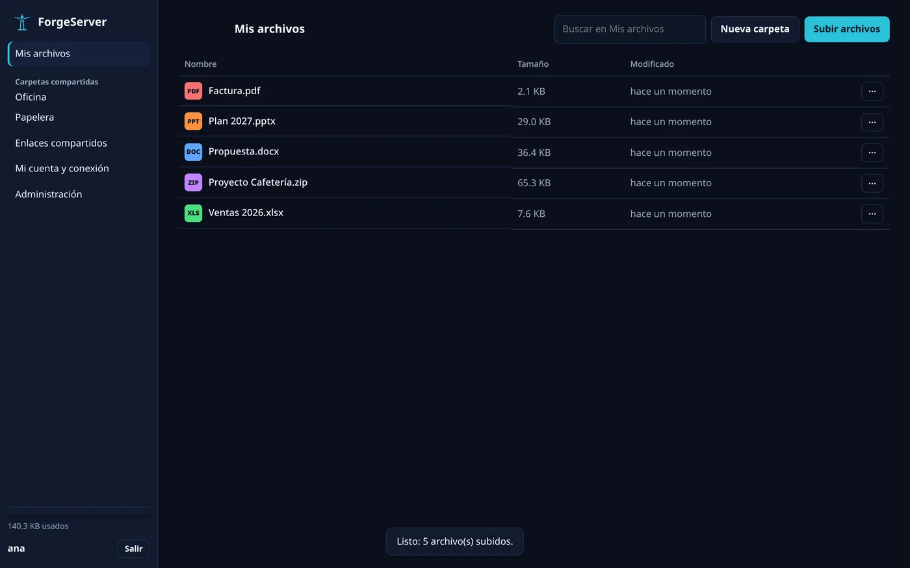

<h1 align="center">Z-FORGE</h1>
<p align="center"><b>A complete office suite that lives on your computer, and on your own server if you want one.</b><br>
Spreadsheets, documents, slides, PDF, email and more. No subscription, no account, works offline.</p>
<p align="center">        </p>
<p align="center"><b>English</b> · <a href="README.es.md">Español</a></p>

<p align="center"><br><sub>SheetForge opening an Excel sales report with its chart</sub></p>

## Get started

The easiest way is **ForgeLauncher**: it installs, opens and updates every app from one window.

1. Download [ForgeLauncher for Linux](https://github.com/znoowmk/zforge-releases/releases/download/forgelauncher-v0.19.5/forgelauncher-0.19.5-linux-x86_64.tar.gz).
2. Unpack it and run `bin/forgelauncher`.
3. Pick the apps you want. It downloads them from here, checks every file, and tells you when there's a new version.

<p align="center"><br><sub>ForgeLauncher</sub></p>

## The apps

| | App | What it's for | Linux x86-64 |
|---|---|---|---|
|  | **SheetForge** | Spreadsheets. Opens `.xlsx`, `.xls`, `.ods` and `.csv`, and your formulas give the same results as in Excel. | [0.19.2](https://github.com/znoowmk/zforge-releases/releases/download/sheetforge-v0.19.2/sheetforge-0.19.2-linux-x86_64.tar.gz) |
|  | **DocForge** | Documents. Write and edit Word files without Word (`.docx`, `.odt`). Comes with **MindForge**, an AI assistant that drafts and proofreads with you, using models on your own computer. | [0.18.1](https://github.com/znoowmk/zforge-releases/releases/download/docforge-v0.18.1/docforge-0.18.1-linux-x86_64.tar.gz) |
|  | **SlideForge** | Slides that look the same as in PowerPoint (`.pptx`, `.odp`), with presenter view. | [0.18.1](https://github.com/znoowmk/zforge-releases/releases/download/slideforge-v0.18.1/slideforge-0.18.1-linux-x86_64.tar.gz) |
|  | **PDFForge** | Read, fill in, sign, merge and split PDFs without uploading them anywhere. | [0.21.1](https://github.com/znoowmk/zforge-releases/releases/download/pdfforge-v0.21.1/pdfforge-0.21.1-linux-x86_64.tar.gz) |
|  | **MailForge** | All your email accounts in one app, with calendar and contacts. | [0.2.0](https://github.com/znoowmk/zforge-releases/releases/download/mailforge-v0.2.0/mailforge-0.2.0-linux-x86_64.tar.gz) |
|  | **ZipForge** | Compress and extract files, with password protection. | [0.2.0](https://github.com/znoowmk/zforge-releases/releases/download/zipforge-v0.2.0/zipforge-0.2.0-linux-x86_64.tar.gz) |
|  | **ForgeServer** | Your own server: everyone's files, shared folders, a network drive and the apps in the browser. | [0.1.0](https://github.com/znoowmk/zforge-releases/releases/download/forgeserver-v0.1.0/forgeserver-0.1.0-linux-x86_64.tar.gz) |
|  | **ForgeLauncher** | Installs and updates the whole suite. | [0.19.5](https://github.com/znoowmk/zforge-releases/releases/download/forgelauncher-v0.19.5/forgelauncher-0.19.5-linux-x86_64.tar.gz) |

Every earlier version is under [Releases](https://github.com/znoowmk/zforge-releases/releases). Windows builds are coming here too.

## A closer look

<p align="center"><br><sub>DocForge — a proposal with headings, lists and a table</sub></p>
<p align="center"><br><sub>SlideForge — a two-slide plan</sub></p>
<p align="center"><br><sub>PDFForge — an invoice, with tools to sign, fill, merge and protect</sub></p>
<p align="center"><br><sub>ZipForge</sub></p>
<p align="center"><br><sub>MailForge before adding an account</sub></p>

DocForge, SlideForge and PDFForge are shown in English: their Spanish interface is on the way.

## Your own server (ForgeServer)

Z-FORGE doesn't make you use anyone's cloud: **you run your own server**, on an office PC, a VPS, a Raspberry Pi or Docker. One 7 MB program with no external database.

- Each person's files from the browser, or as a network drive (WebDAV) on Windows, macOS and Linux.
- Share links that expire, and a storage quota per person.
- SheetForge, DocForge and SlideForge in the browser.

<p align="center"><br><sub>ForgeServer in the browser</sub></p>

Guides (Spanish): [Install ForgeServer](docs/forgeserver-instalar.md) · [Security](docs/forgeserver-seguridad.md)

## Install an app by hand (Linux)

```bash
tar xzf sheetforge-0.19.2-linux-x86_64.tar.gz
cd sheetforge-0.19.2-linux-x86_64
./bin/sheetforge
```

To add it to your menu, copy `share/` into `~/.local/share/` and `bin/` into `~/.local/bin/`. Runs on any Linux from 2023 on (glibc 2.36 or newer).

**Check the download:** every release has a `SHA256SUMS.txt`. Put it next to the file and run `sha256sum -c SHA256SUMS.txt`; it should say `OK`. ForgeLauncher does this for you.

## Why Z-FORGE instead of Office?

| | Z-FORGE | Microsoft 365 |
|---|---|---|
| Price | Free, no subscription | Monthly or yearly subscription |
| Where your files are | On your computer or your own server | In Microsoft's cloud |
| Offline | Everything | Partly |
| Excel formulas | Same results: we compared 239,877 formulas from 1,835 real Excel files and none differed | — |
| Macros | Macros AI: say what you want automated and it builds and tests the macro; it also translates VBA | VBA |
| Size | Native apps that open instantly | Several GB to install |
| Your own server | ForgeServer, 7 MB | SharePoint / Exchange |

## Report a problem

Open an [issue](https://github.com/znoowmk/zforge-releases/issues) with the app, its version and, if you can, the file that fails (without private data).

---
© 2026 Znoow · Z-FORGE
