<h1 align="center">Z-FORGE</h1>
<p align="center"><b>A complete office suite that lives on your computer, and on your own server if you want one.</b><br>
Spreadsheets, documents, slides, PDF, email and more. No subscription, no account, works offline.</p>
<p align="center">            </p>
<p align="center"><b>English</b> · <a href="README.es.md">Español</a></p>

<p align="center">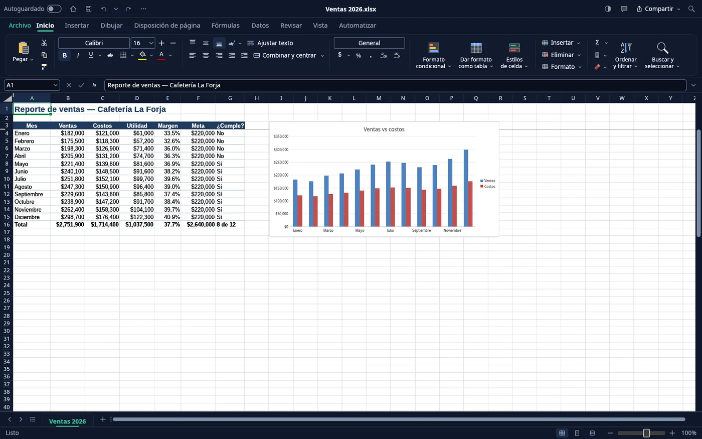<br><sub>SheetForge opening an Excel sales report with its chart</sub></p>

## Get started

**Windows:** in the table below, download the app's **Installer** and open it: Next → Install, and it shows up in the Start menu and on the desktop. No administrator password needed, and you remove it like any program from *Settings → Apps*. If you'd rather not install anything, download the **.exe** and open it directly.

> [!IMPORTANT]
> **Windows will show a warning the first time. That's expected.**
> Z-FORGE programs don't have a paid code-signing certificate yet (one costs 200–400 USD a year), so Windows doesn't recognize the publisher and shows **"Windows protected your PC"**. To open it:
> 1. Click **More info**.
> 2. Click **Run anyway**.
>
> It only asks once per file. If your browser (Edge or Chrome) says the file "isn't commonly downloaded", choose **⋯ → Keep** (in Edge: *Show more → Keep anyway*).
> Want to check the file is the original? Each release has `SHA256SUMS.txt`; in PowerShell: `Get-FileHash .\file.exe` and compare the number.

**Linux:** paste this in a terminal and press Enter:

```bash
curl -fsSL https://raw.githubusercontent.com/znoowmk/zforge-releases/main/instalar.sh | sh
```

That installs **ForgeLauncher** with its icon in your menu. Open it and pick the apps: it downloads, installs and updates them for you. No administrator password needed.

<p align="center">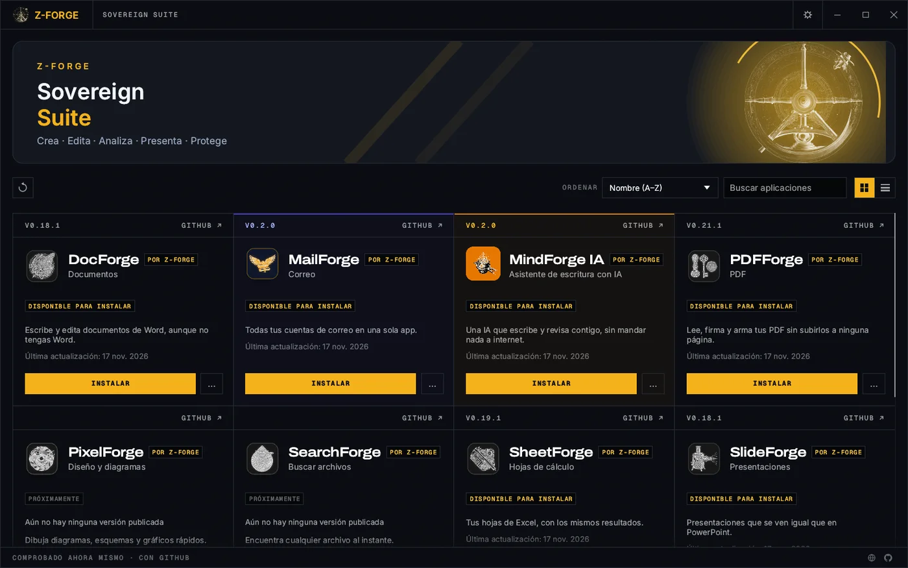<br><sub>ForgeLauncher</sub></p>


## The apps

| | App | What it's for | Linux | Windows |
|---|---|---|---|---|
|  | **SheetForge** | Spreadsheets. Opens `.xlsx`, `.xls`, `.ods` and `.csv`, and your formulas give the same results as in Excel. Comes with **AI Macros**: say what to automate and it writes the macro, tests it on a copy and shows what would change. | [0.19.5](https://github.com/znoowmk/zforge-releases/releases/download/sheetforge-v0.19.5/sheetforge-0.19.5-linux-x86_64.tar.gz) | [Installer](https://github.com/znoowmk/zforge-releases/releases/download/sheetforge-v0.19.5/sheetforge-0.19.5-windows-x64-setup.exe) · [.exe](https://github.com/znoowmk/zforge-releases/releases/download/sheetforge-v0.19.5/sheetforge-0.19.5-windows-x64.exe) · [.zip](https://github.com/znoowmk/zforge-releases/releases/download/sheetforge-v0.19.5/sheetforge-0.19.5-windows-x64-portable.zip) |
|  | **DocForge** | Documents. Write and edit Word files without Word (`.docx`, `.odt`). Comes with **MindForge**, an AI assistant that rewrites, proofreads, summarizes and translates with models on your own computer. | [0.18.4](https://github.com/znoowmk/zforge-releases/releases/download/docforge-v0.18.4/docforge-0.18.4-linux-x86_64.tar.gz) | [Installer](https://github.com/znoowmk/zforge-releases/releases/download/docforge-v0.18.4/docforge-0.18.4-windows-x64-setup.exe) · [.exe](https://github.com/znoowmk/zforge-releases/releases/download/docforge-v0.18.4/docforge-0.18.4-windows-x64.exe) · [.zip](https://github.com/znoowmk/zforge-releases/releases/download/docforge-v0.18.4/docforge-0.18.4-windows-x64-portable.zip) |
|  | **SlideForge** | Slides that look the same as in PowerPoint (`.pptx`, `.odp` and old `.ppt` files), with charts, SmartArt, transitions and presenter view. | [0.18.4](https://github.com/znoowmk/zforge-releases/releases/download/slideforge-v0.18.4/slideforge-0.18.4-linux-x86_64.tar.gz) | [Installer](https://github.com/znoowmk/zforge-releases/releases/download/slideforge-v0.18.4/slideforge-0.18.4-windows-x64-setup.exe) · [.exe](https://github.com/znoowmk/zforge-releases/releases/download/slideforge-v0.18.4/slideforge-0.18.4-windows-x64.exe) · [.zip](https://github.com/znoowmk/zforge-releases/releases/download/slideforge-v0.18.4/slideforge-0.18.4-windows-x64-portable.zip) |
|  | **PDFForge** | Read, fill in, sign, merge, split, redact and protect PDFs without uploading them anywhere. With OCR for scans and an AI assistant that **summarizes, answers questions and translates** the document. | [0.21.4](https://github.com/znoowmk/zforge-releases/releases/download/pdfforge-v0.21.4/pdfforge-0.21.4-linux-x86_64.tar.gz) | [Installer](https://github.com/znoowmk/zforge-releases/releases/download/pdfforge-v0.21.4/pdfforge-0.21.4-windows-x64-setup.exe) · [.exe](https://github.com/znoowmk/zforge-releases/releases/download/pdfforge-v0.21.4/pdfforge-0.21.4-windows-x64.exe) · [.zip](https://github.com/znoowmk/zforge-releases/releases/download/pdfforge-v0.21.4/pdfforge-0.21.4-windows-x64-portable.zip) |
|  | **MailForge** | All your email accounts in one app, with calendar, tasks and contacts. Summarizes and translates mail with AI on your computer. | [0.2.1](https://github.com/znoowmk/zforge-releases/releases/download/mailforge-v0.2.1/mailforge-0.2.1-linux-x86_64.tar.gz) | [Installer](https://github.com/znoowmk/zforge-releases/releases/download/mailforge-v0.2.1/mailforge-0.2.1-windows-x64-setup.exe) · [.exe](https://github.com/znoowmk/zforge-releases/releases/download/mailforge-v0.2.1/mailforge-0.2.1-windows-x64.exe) · [.zip](https://github.com/znoowmk/zforge-releases/releases/download/mailforge-v0.2.1/mailforge-0.2.1-windows-x64-portable.zip) |
|  | **ZipForge** | Compress and extract files, with a password if you like. Preview photos, PDF, Word, Excel and PowerPoint **inside the archive without extracting them**. | [0.2.1](https://github.com/znoowmk/zforge-releases/releases/download/zipforge-v0.2.1/zipforge-0.2.1-linux-x86_64.tar.gz) | [Installer](https://github.com/znoowmk/zforge-releases/releases/download/zipforge-v0.2.1/zipforge-0.2.1-windows-x64-setup.exe) · [.exe](https://github.com/znoowmk/zforge-releases/releases/download/zipforge-v0.2.1/zipforge-0.2.1-windows-x64.exe) · [.zip](https://github.com/znoowmk/zforge-releases/releases/download/zipforge-v0.2.1/zipforge-0.2.1-windows-x64-portable.zip) |
|  | **GalleryForge** | Your photos by folder: thumbnails, a full-screen viewer, rotate and move to trash. | [0.2.0](https://github.com/znoowmk/zforge-releases/releases/download/galleryforge-v0.2.0/galleryforge-0.2.0-linux-x86_64.tar.gz) | [Installer](https://github.com/znoowmk/zforge-releases/releases/download/galleryforge-v0.2.0/galleryforge-0.2.0-windows-x64-setup.exe) · [.exe](https://github.com/znoowmk/zforge-releases/releases/download/galleryforge-v0.2.0/galleryforge-0.2.0-windows-x64.exe) · [.zip](https://github.com/znoowmk/zforge-releases/releases/download/galleryforge-v0.2.0/galleryforge-0.2.0-windows-x64-portable.zip) |
|  | **PixelForge** | Edit photos: exposure, contrast, saturation, temperature, vignette and sharpness, one-click looks, rotate and pixelate areas to hide details. It is GalleryForge opened straight in its editor. | [0.2.0](https://github.com/znoowmk/zforge-releases/releases/download/pixelforge-v0.2.0/pixelforge-0.2.0-linux-x86_64.tar.gz) | [Installer](https://github.com/znoowmk/zforge-releases/releases/download/pixelforge-v0.2.0/pixelforge-0.2.0-windows-x64-setup.exe) · [.exe](https://github.com/znoowmk/zforge-releases/releases/download/pixelforge-v0.2.0/pixelforge-0.2.0-windows-x64.exe) · [.zip](https://github.com/znoowmk/zforge-releases/releases/download/pixelforge-v0.2.0/pixelforge-0.2.0-windows-x64-portable.zip) |
|  | **SearchForge** | Find any file on your disk instantly as you type (hundreds of thousands in under a second), also by what's inside. | [0.3.0](https://github.com/znoowmk/zforge-releases/releases/download/searchforge-v0.3.0/searchforge-0.3.0-linux-x86_64.tar.gz) | [Installer](https://github.com/znoowmk/zforge-releases/releases/download/searchforge-v0.3.0/searchforge-0.3.0-windows-x64-setup.exe) · [.exe](https://github.com/znoowmk/zforge-releases/releases/download/searchforge-v0.3.0/searchforge-0.3.0-windows-x64.exe) · [.zip](https://github.com/znoowmk/zforge-releases/releases/download/searchforge-v0.3.0/searchforge-0.3.0-windows-x64-portable.zip) |
|  | **MindForge** | The suite's AI assistant as an app of its own: chat with models that run on your computer (Ollama). | [0.2.0](https://github.com/znoowmk/zforge-releases/releases/download/mindforge-v0.2.0/mindforge-0.2.0-linux-x86_64.tar.gz) | — |
|  | **ForgeServer** | Your own server: everyone's files, shared folders, a network drive and the apps in the browser. | [0.2.0](https://github.com/znoowmk/zforge-releases/releases/download/forgeserver-v0.2.0/forgeserver-0.2.0-linux-x86_64.tar.gz) | [Installer](https://github.com/znoowmk/zforge-releases/releases/download/forgeserver-v0.2.0/forgeserver-0.2.0-windows-x64-setup.exe) · [.exe](https://github.com/znoowmk/zforge-releases/releases/download/forgeserver-v0.2.0/forgeserver-0.2.0-windows-x64.exe) · [.zip](https://github.com/znoowmk/zforge-releases/releases/download/forgeserver-v0.2.0/forgeserver-0.2.0-windows-x64-portable.zip) |
|  | **ForgeLauncher** | Installs and updates the whole suite. | [0.19.6](https://github.com/znoowmk/zforge-releases/releases/download/forgelauncher-v0.19.6/forgelauncher-0.19.6-linux-x86_64.tar.gz) | [Installer](https://github.com/znoowmk/zforge-releases/releases/download/forgelauncher-v0.19.6/forgelauncher-0.19.6-windows-x64-setup.exe) · [.exe](https://github.com/znoowmk/zforge-releases/releases/download/forgelauncher-v0.19.6/forgelauncher-0.19.6-windows-x64.exe) · [.zip](https://github.com/znoowmk/zforge-releases/releases/download/forgelauncher-v0.19.6/forgelauncher-0.19.6-windows-x64-portable.zip) |

Every earlier version is under [Releases](https://github.com/znoowmk/zforge-releases/releases). On Windows there are three options: the **Installer** (recommended), the **.exe** alone, or the portable **.zip** to carry on a USB stick. PDFForge's .exe alone doesn't include text recognition (OCR) for scanned documents; the Installer and the .zip do.

## A closer look

<p align="center">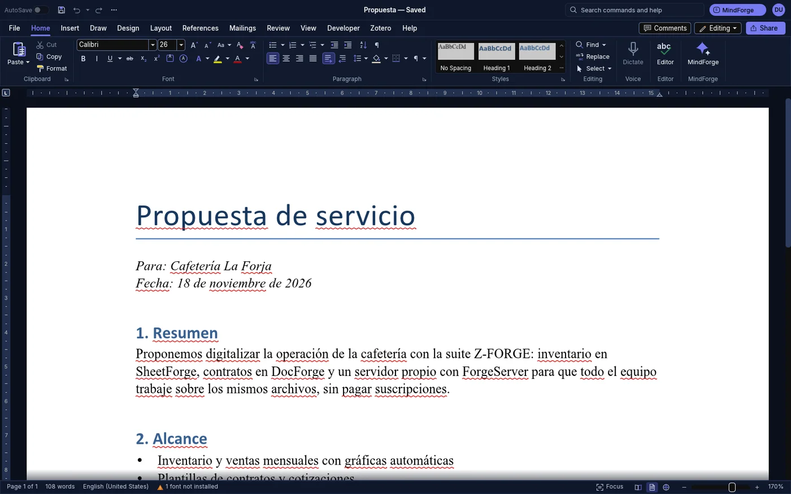<br><sub>DocForge — a proposal with headings, lists and a table</sub></p>
<p align="center">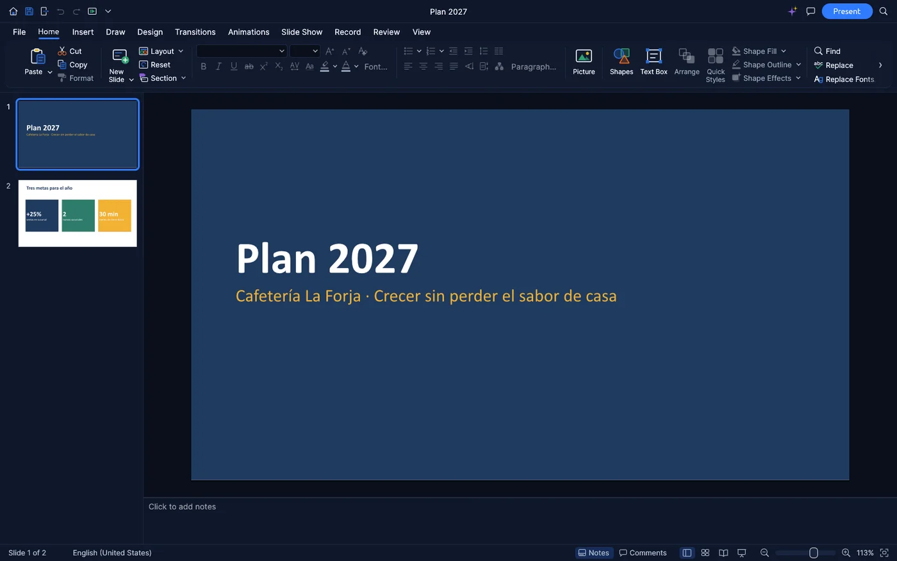<br><sub>SlideForge — a two-slide plan</sub></p>
<p align="center">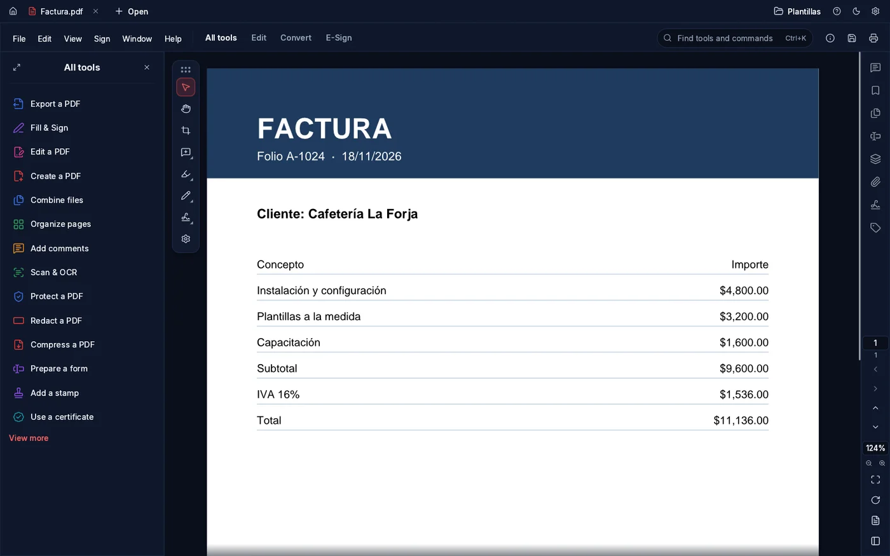<br><sub>PDFForge — an invoice, with tools to sign, fill, merge and protect</sub></p>
<p align="center">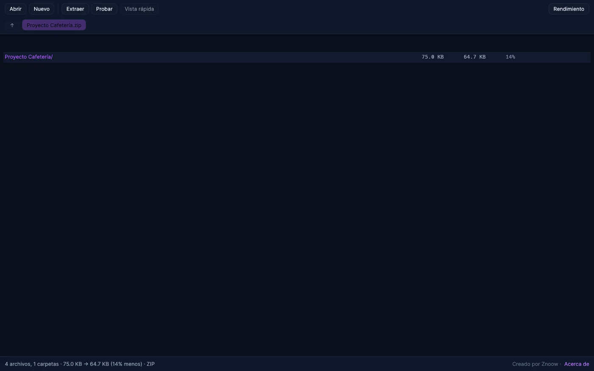<br><sub>ZipForge</sub></p>
<p align="center">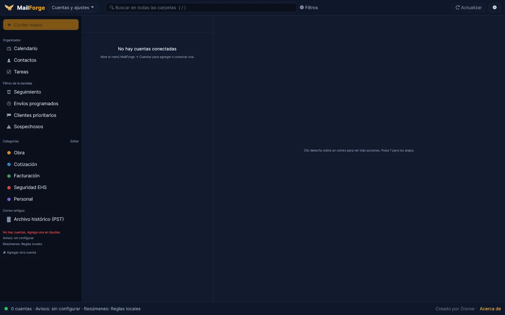<br><sub>MailForge before adding an account</sub></p>
<p align="center">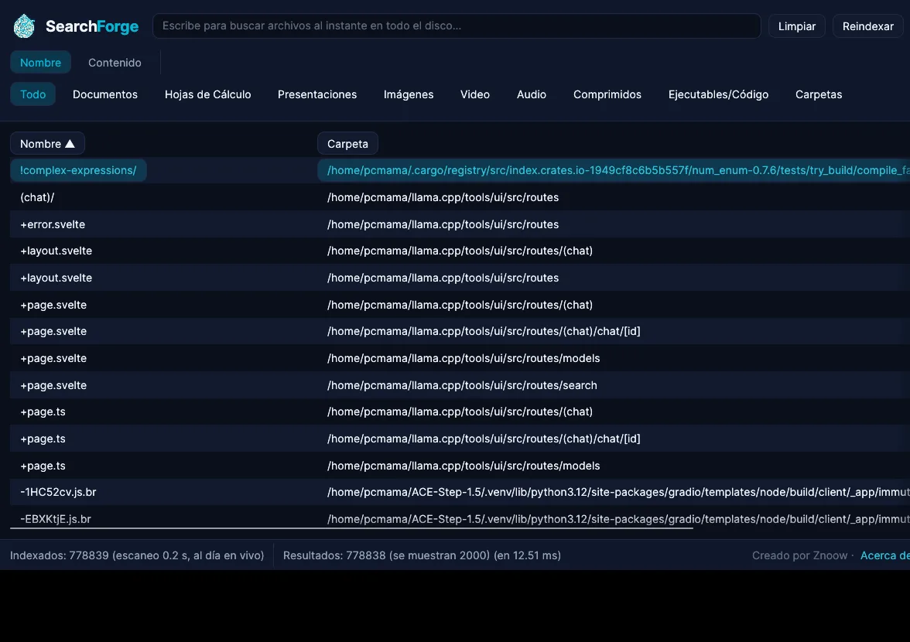<br><sub>SearchForge — 778 thousand files indexed and searchable instantly</sub></p>
<p align="center">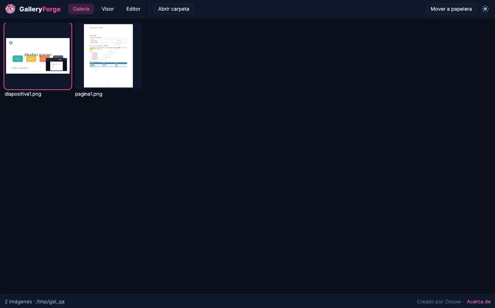<br><sub>GalleryForge in dark mode</sub></p>
<p align="center">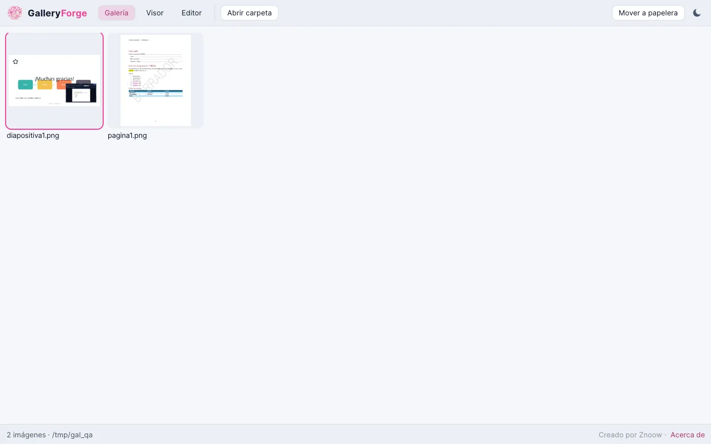<br><sub>…and in light mode</sub></p>

The apps follow your system language (English and Spanish everywhere, more languages in DocForge and PDFForge).

## Your own server (ForgeServer)

Z-FORGE doesn't make you use anyone's cloud: **you run your own server**, on an office PC, a VPS, a Raspberry Pi or Docker. One 7 MB program with no external database.

1. Download ForgeServer, unpack it and run `bin/forgeserver`.
2. It shows the address for the other computers and a one-time code. Open the address, type the code and create the administrator account.
3. In **Administration**, add people and create shared folders (for example "Office").

- Each person's files from the browser (PDF, picture and text previews, search, drag to upload) or as a network drive on Windows, macOS and Linux, to open and save straight from the apps.
- Shared folders several people work in.
- A 30-day trash and the last 10 versions of every file, also from the network drive.
- Share links that expire, and a storage quota per person.

<p align="center"><br><sub>ForgeServer in the browser</sub></p>
<p align="center">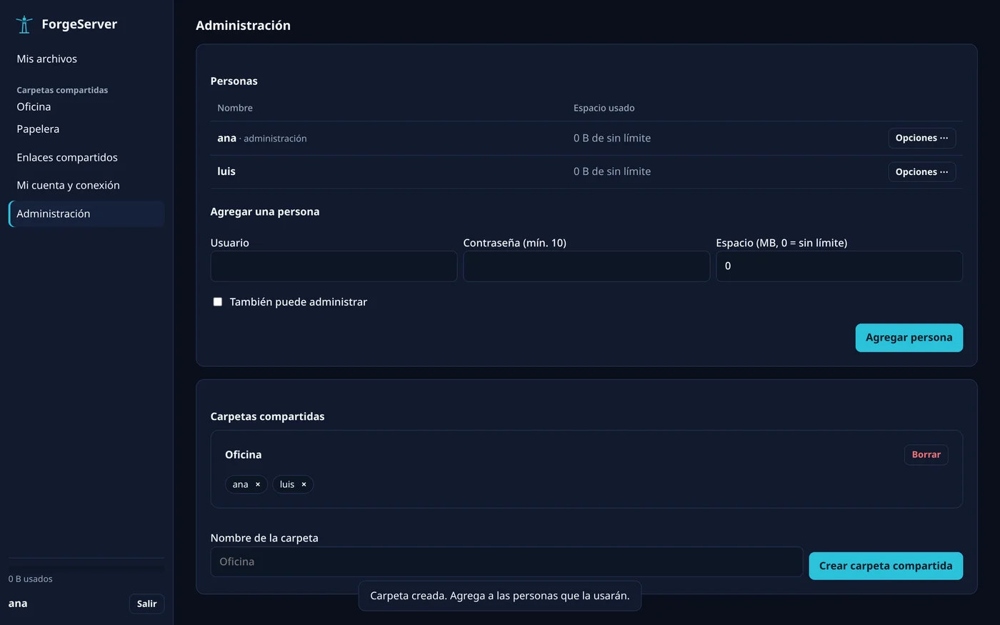<br><sub>People and shared folders, managed from the browser</sub></p>

Guides (Spanish): [Install ForgeServer](docs/forgeserver-instalar.md) · [Security](docs/forgeserver-seguridad.md)

<details>
<summary><b>Advanced:</b> install by hand and check the download</summary>

On Linux, without ForgeLauncher:

```bash
tar xzf sheetforge-0.19.5-linux-x86_64.tar.gz
./sheetforge-0.19.5-linux-x86_64/bin/sheetforge
```

Runs on any Linux from 2023 on (glibc 2.36 or newer).

**What is `SHA256SUMS.txt`?** Optional. It lists each published file's fingerprint: if your download has the same one, it arrived whole and untouched. ForgeLauncher and the installer above check it for you. By hand: put it next to your download and run `sha256sum -c --ignore-missing SHA256SUMS.txt`; it should say `OK`.

</details>

## AI on your own computer

Z-FORGE's AI runs **on your computer** with [Ollama](https://ollama.com): your documents never go to anyone's cloud. Install Ollama, download a model (`ollama pull mistral-nemo`) and that's it; each app finds the installed model on its own.

| App | What the AI does |
|---|---|
| DocForge (MindForge) | Improves wording, fixes spelling, summarizes, switches to an executive tone, expands ideas and translates; inserts or replaces the text in your document |
| SheetForge (AI Macros) | Writes macros from what you ask, tests them on a copy of the workbook and shows which cells would change before saving |
| PDFForge | Summarizes the PDF, answers questions about it and translates it (PDFs that forbid copying their text are respected) |
| MailForge | Summarizes a message with a suggested reply and translates it |

Prefer another server? `OLLAMA_HOST` points to another machine on your network and `FORGE_AI_MODEL` picks the model.

## Light and dark

Every app has a light and a dark look. In ZipForge, SearchForge, GalleryForge, PixelForge and MailForge the sun/moon button switches **all of them at once**, and right click → *Same as the system* follows your desktop. DocForge, SheetForge, SlideForge and PDFForge have their own switch in the title bar or under View.

## Why Z-FORGE instead of Office?

| | Z-FORGE | Microsoft 365 |
|---|---|---|
| Price | Free, no subscription | Monthly or yearly subscription |
| Where your files are | On your computer or your own server | In Microsoft's cloud |
| Offline | Everything | Partly |
| Excel formulas | Same results: we compared 239,877 formulas from 1,835 real Excel files and none differed | — |
| Macros | Macros AI: say what you want automated and it builds and tests the macro; it also translates VBA | VBA |
| Size | Native apps that open instantly | Several GB to install |
| Your own server | ForgeServer, 7 MB | SharePoint / Exchange |

## Report a problem

Open an [issue](https://github.com/znoowmk/zforge-releases/issues) with the app, its version and, if you can, the file that fails (without private data).

---
© 2026 Znoow · Z-FORGE
